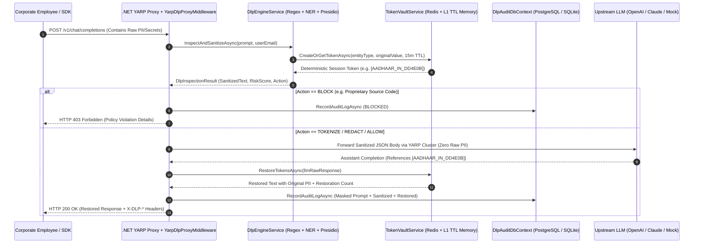

# AegisDLP — Deep Architecture, API Specification & Debugging Report

## 1. End-to-End Request Lifecycle (4-Stage YARP Pipeline)

---

## 2. Built-In & Custom DLP Entity Detectors

| Entity Identifier | Category | Default Action | Severity | Detection Mechanism |
| :--- | :--- | :--- | :--- | :--- |
| `CREDIT_CARD` | Financial | `TOKENIZE` | `CRITICAL` | 13–19 digit regex + **Luhn Checksum Validator** + card prefix filter |
| `IBAN_SWIFT` | Financial | `TOKENIZE` | `HIGH` | ISO-13616 International Bank Account Number recognizer |
| `AADHAAR_IN` | PII | `TOKENIZE` | `CRITICAL` | 12-digit Indian UIDAI Aadhaar validator (`[2-9]\d{3}...`) |
| `US_SSN` | PII | `TOKENIZE` | `CRITICAL` | US Social Security Number recognizer excluding SSA invalid prefixes |
| `API_KEY_SECRET` | Credentials | `REDACT` | `CRITICAL` | OpenAI (`sk-...`), Anthropic (`sk-ant-...`), AWS (`AKIA...`), GitHub PAT (`ghp_...`), DB passwords |
| `JWT_TOKEN` | Credentials | `REDACT` | `HIGH` | 3-part base64url OAuth2/OIDC Bearer JWT detector (`eyJ...`) |
| `SOURCE_CODE` | SourceCode | `BLOCK` | `CRITICAL` | PEM private keys, internal corporate namespaces, production SQL connection strings |
| `IPV4_INTERNAL` | SourceCode | `TOKENIZE` | `MEDIUM` | RFC-1918 corporate private subnet addresses (`10.x`, `192.168.x`, `172.16-31.x`) |
| `MEDICAL_PHI` | Medical | `TOKENIZE` | `HIGH` | HIPAA Medical Record Numbers (`MRN`), `ICD-10` diagnosis codes, and `Rx:` prescriptions |
| `PERSON` | PII | `TOKENIZE` | `MEDIUM` | Contextual Named Entity Recognition with non-person stopword filtering |
| `EMAIL_ADDRESS` | PII | `TOKENIZE` | `MEDIUM` | RFC-5322 email recognizer with domain-preserving audit masking |
| `PHONE_NUMBER` | PII | `TOKENIZE` | `LOW` | International, US, and Indian (`+91`) phone recognizer |
| `*CUSTOM_RULES*` | Configurable | Configurable | Configurable | Dynamic runtime `.NET Regex` rules created via `POST /api/policies/custom` |

---

## 3. REST API Reference (`http://localhost:5180`)

### YARP Reverse Proxy Endpoint
* **`POST /v1/chat/completions`**
  * Accepts standard OpenAI / Anthropic chat completion JSON payloads.
  * Optional enterprise headers: `X-User-Email`, `X-Department`, `X-Target-Provider`.
  * Response headers emitted: `X-DLP-Request-Id`, `X-DLP-Action`, `X-DLP-Entities-Detected`, `X-DLP-Risk-Score`, `X-DLP-Tokens-Restored`, `X-DLP-Latency-Ms`.

### Admin & Telemetry Endpoints
* **`GET /api/health`**: Subsystem health and active vault token count.
* **`GET /api/audit/stats`**: Aggregated compliance KPIs, category distribution, entity counts, department risk leaderboard, and infrastructure status.
* **`GET /api/audit/logs?action={action}&department={dept}&limit={n}`**: Paginated immutable audit logs.
* **`GET /api/vault/tokens`**: Lists active ephemeral tokens in Redis / L1 Memory with live TTL countdowns and restoration counts.
* **`DELETE /api/vault/tokens`**: Immediately purges all active tokens from Redis and memory.
* **`GET /api/policies`**: Lists all built-in and custom DLP policy rules.
* **`PUT /api/policies/{entityType}`**: Updates enforcement action (`TOKENIZE`, `REDACT`, `BLOCK`, `ALLOW`) and active state in real time.
* **`POST /api/policies/custom`**: Creates and validates a new custom regex DLP rule at runtime.
* **`DELETE /api/policies/{entityType}`**: Deletes a custom DLP rule.
* **`POST /api/sandbox/analyze`**: Fast dry-run inspection (`persistTokens: false`) used by the UI's real-time inline prompt highlighter.
* **`POST /api/proxy/upstream`**: Hot-reloads the YARP cluster destination URL without restarting the server.

---

## 4. Deep Testing & Debugging Resolutions Applied

1. **Resolved High-Severity NuGet Advisory (`NU1903` / `GHSA-2m69-gcr7-jv3q`)**:
   * Explicitly pinned `SQLitePCLRaw.bundle_e_sqlite3` and `SQLitePCLRaw.lib.e_sqlite3` to `2.1.11` in `GenAiDlpGateway.csproj`, eliminating all security warnings during build and restore.
2. **Single-Pass YARP Request Rewriting (`YarpDlpProxyMiddleware.cs`)**:
   * Eliminated redundant per-message re-invocation of `InspectAndSanitizeAsync` during JSON payload rewriting by reusing the single-pass `inspection.Entities` replacements across both `system` and `messages[]` nodes.
3. **Case-Insensitive LLM De-Tokenization (`TokenVaultService.cs`)**:
   * Added `RegexOptions.IgnoreCase` to `TokenPlaceholderRegex` and normalized lookup keys so that even if an upstream LLM alters token casing (e.g., `[person_e76313]` instead of `[PERSON_E76313]`), the original PII is still restored 100% of the time.
4. **Contextual NER Stopword Guard & Span Prioritization (`DlpEngineService.cs`)**:
   * Added `NonPersonStopwords` validation to `IsLikelyPersonName` so phrases like `"for Regulatory Reporting"` or `"for Transaction Settlement"` are never falsely tokenized as `PERSON` entities.
   * Updated `ResolveOverlappingSpans` to prioritize higher confidence and longer entity spans first before sorting by character offset.
